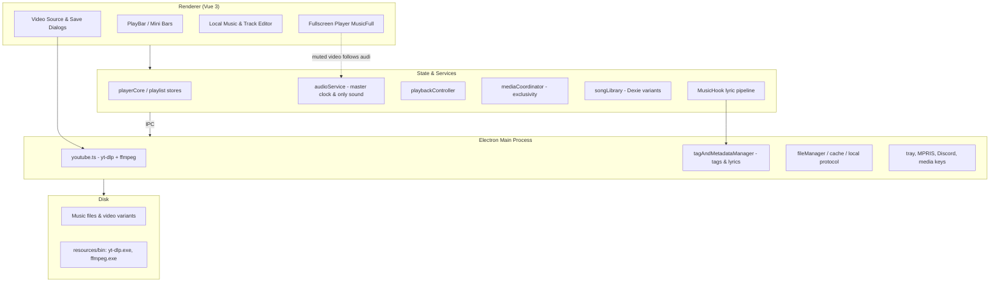
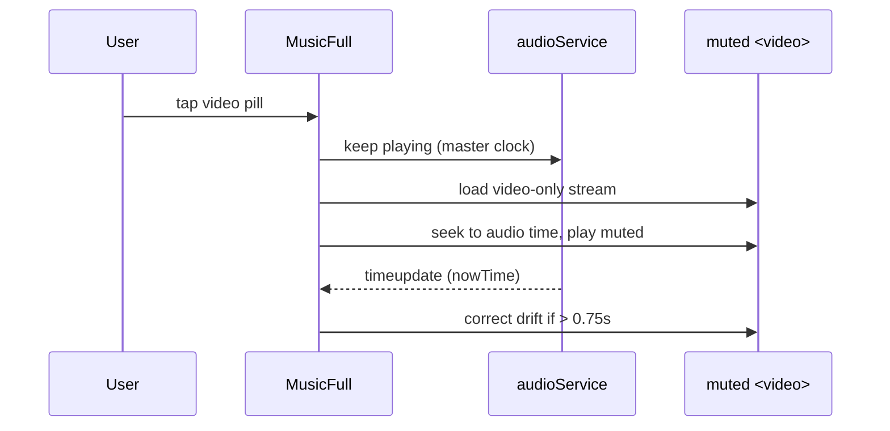

# System Architecture (`ARCHITECTURE.md`)
> **1-Line Summary:** Plain-English visual map of how the app works, why we chose each tool, and step-by-step recipes for adding new features.

## 1. High-Level Visual System Map

## 2. Tech Stack & Why We Chose It

| Layer | Tool / Library | Plain-English Reason Why |
| --- | --- | --- |
| Desktop shell | Electron | Windows-native window, media keys, tray, and local file access while keeping one web codebase. |
| Frontend | Vue 3 + Vite + TypeScript | Reactive UI with fast builds; strict types catch breakage before the GUI can be tested. |
| Component kit | Naive UI + Tailwind + Sass | Polished dark/light theming with utility styling for proportional spacing. |
| State | Pinia (+ persisted state) | One predictable store layer that survives restarts. |
| Local library | Dexie / IndexedDB | Fast offline song/variant database with versioned schema. |
| Audio engine | HTMLAudioElement + WebAudio | Gapless seeking with EQ/crossfade; one persistent element keeps one clock. |
| Media tools | Bundled `yt-dlp` + `ffmpeg` | No external installs; video search/download and tag writing work out of the box. |
| Tagging | node-id3, flac-tagger, music-metadata | Native ID3v2/Vorbis/MP4 tag reading and writing per format. |
| Theming | node-vibrant | Pulls palette colors from album art for the dynamic gradient. |

## 3. Core Subsystems & Engineering Tricks

### [SUBSYSTEM: Linked-AV-Playback-Engine] | Aliases: video mode, muted video, shared clock, audio master
> **1-Line Summary:** The audio element is always the master clock and only sound source; the video is muted and follows it, so the two can never drift apart audibly.
* **How It Works (Plain English):** Entering video mode keeps audio playing. When the video's metadata is ready it is seeked to the audio's current time and plays muted. A slave watcher plays/pauses the video with the shared play state, and any drift beyond 0.75s is corrected on each video tick. Streams and downloads are video-only, so no duplicated audio exists anywhere.
* **Data Flow Diagram:**

* **Code Anchors (Grep Targets):**
  * `src/renderer/components/lyric/MusicFull.vue` -> `enterVideoMode`, `syncVideoSlaveState`, `onVideoTimeUpdate`
  * `src/renderer/store/modules/playerCore.ts` -> `setPlaybackMode`

### [SUBSYSTEM: Single-Play-State-Arbitration] | Aliases: play button state, pause everything, isPlay
> **1-Line Summary:** One boolean play state, written by one rule set, drives every button and pause stops every surface at once.
* **How It Works (Plain English):** `setIsPlay` is the only writer of the play flag. Late crossfade pause events are ignored while another surface owns playback, resuming cancels pending fade-out pauses, and pausing asks the media coordinator to stop every registered element.
* **Code Anchors (Grep Targets):**
  * `src/renderer/store/modules/playerCore.ts` -> `setIsPlay`, `handlePause`
  * `src/renderer/hooks/MusicHook.ts` -> `setupAudioListeners`
  * `src/renderer/services/audioService.ts` -> `pause`, `cancelFadeTimer`
  * `src/renderer/services/mediaCoordinator.ts` -> `pauseAllLocal`, `toggleActiveNonAudioPlayback`

### [SUBSYSTEM: Per-Song-Media-Lifecycle] | Aliases: track change reset, stale video, song id matching
> **1-Line Summary:** Video, quality, and YouTube link belong to one song ID and are fully dropped the moment the track changes.
* **How It Works (Plain English):** `playTrack` resets playback mode on a new song ID; the fullscreen player clears its video state, the MV drawer closes, and the pill recomputes. Stream URLs are also prefetched per song so switching to video later is instant.
* **Code Anchors (Grep Targets):**
  * `src/renderer/services/playbackController.ts` -> `playTrack`
  * `src/renderer/store/modules/playerCore.ts` -> `resetMediaStateForNewSong`
  * `src/renderer/components/lyric/MusicFull.vue` -> `resetVideoStateForNewSong`, `prefetchVideoStream`

### [SUBSYSTEM: YouTube-Engine] | Aliases: yt-dlp, ffmpeg, video download, quality ladder, video only
> **1-Line Summary:** Bundled yt-dlp finds formats and downloads video-only files; ffmpeg handles tag writing and legacy stream muxing.
* **How It Works (Plain English):** Format lists come from `yt-dlp -J`, grouped into one row per height and codec. Downloads select the exact format ID and skip the audio merge (linked playback supplies audio). A 4-hour cache serves stream URLs; the old ffmpeg DASH mux proxy remains only as a seek fallback.
* **Code Anchors (Grep Targets):**
  * `src/main/modules/youtube.ts` -> `getStreamUrl`, `downloadMedia`, `getYtDlpJson`, `ensureProxyServer`, `getFfmpegPath`
  * `src/main/modules/youtubeFormats.ts` -> `mapAndGroupFormats`, `normalizeCodec`
  * `src/renderer/utils/videoQualityHelpers.ts` -> `getUniqueVideoHeights`

### [SUBSYSTEM: Lyric-Pipeline] | Aliases: lyrics, lrc, timestamps, edit lrc, offset
> **1-Line Summary:** Lyrics load from sidecar files, embedded tags, cache or LRCLIB, render with per-line timestamps and offsets, and can be edited live in LRC form.
* **How It Works (Plain English):** Lines carry start times in milliseconds; the shared clock computes the active line. "Edit LRC" applies raw `[mm:ss.xxx]` text straight into the live arrays and saves to tags plus sidecar for local files. The offset control shifts all lines per song and is remembered.
* **Code Anchors (Grep Targets):**
  * `src/renderer/hooks/MusicHook.ts` -> `getLrcIndex`, `setAudioTime`, `setCorrectionTime`
  * `src/renderer/utils/lyrics.ts` -> `formatLrcTimestampMs`, `parseLrcTimestamp`, `nudgeTimestamp`
  * `src/renderer/components/lyric/MusicFull.vue` -> `handleApplyEditedLrc`, `lineTimeLabel`

### [SUBSYSTEM: Unified-Song-Library] | Aliases: variants, dexie, fingerprint, duplicates, song identity
> **1-Line Summary:** One Dexie database links every audio/video/lyrics file to a single song record using artist|title identity plus fingerprint matching.
* **How It Works (Plain English):** Ingestion matches by path, YouTube ID, fingerprint, normalized `artist|title` key with ±3s duration, then fuzzy token similarity. Variants record codec, height, bitrate and size so the Files tab can manage each one independently (unlink keeps the file, delete removes it).
* **Code Anchors (Grep Targets):**
  * `src/renderer/services/songLibrary.ts` -> `computeNormKey`, `ingestLocalTrack`, `linkVariant`, `getVariants`, `findSongByPath`, `getSongKey`

### [SUBSYSTEM: Tag-Metadata-And-Lyric-IO] | Aliases: tags, artwork, rename, lrclib, metadata fetch
> **1-Line Summary:** The main process writes native tags and sidecar lyrics per format and fetches metadata/lyrics from iTunes, MusicBrainz and LRCLIB.
* **How It Works (Plain English):** `node-id3` handles MP3, `flac-tagger` FLAC, and ffmpeg the iTunes atoms for m4a/mp4/opus/ogg/wav. Lyric search returns candidates with duration and offset metadata so the picker can prefer the closest version.
* **Code Anchors (Grep Targets):**
  * `src/main/modules/tagAndMetadataManager.ts` -> `fetchFromITunes`, `fetchFromMusicBrainz`, `lrcTimeBounds`, `local-music:update-tags-and-file`

### [SUBSYSTEM: Local-Media-Runtime] | Aliases: local protocol, range seeking, scanner, covers
> **1-Line Summary:** Local files stream through a loopback protocol with range seeking and cover extraction, and are scanned into the library in the background.
* **How It Works (Plain English):** Chromium cannot seek custom schemes, so playable URLs are converted at playback time while stored URLs stay `local://` for identity checks. Covers come from embedded art or folder images.
* **Code Anchors (Grep Targets):**
  * `src/renderer/utils/localMediaUrl.ts` -> `toPlayableMediaUrl`, `filePathToMediaUrl`
  * `src/renderer/utils/localMusicUtils.ts` -> `toSongResult`, `parseLrcToILyric`
  * `src/renderer/hooks/IndexDBHook.ts` -> `musicDB`, `getMusicDBInstance`

## 4. Verification & Health Checks

### [VERIFY: Automated-Check-Suite] | Aliases: test commands, build check, typecheck, lint, sweep gate
> **1-Line Summary:** Commands every AI must run to prove nothing broke before committing.
* **Type & Lint Check:** `npm run typecheck:web` and `npm run typecheck:node` (both must exit 0); `npx eslint ./src` (the `no-empty` count must stay 0). On a fresh clone run `npm run build` first — it generates the gitignored `auto-imports.d.ts` / `components.d.ts` stubs that the type checks require.
* **Automated UI / Logic Verification:** `npx vitest run` (all unit tests must pass).
* **English-Sweep Gate:** `node .sweep-gate.mjs` (must report 0 unexplained CJK lines).
* **Bundle Check:** `npm run build` (electron-vite build must exit 0).
* **Portable `.exe` Packaging Command:** `npm run build:portable` (rapid-test artifact); `npm run build:installer` (NSIS).

## 5. Recipes: How to Add New Things Safely

* **To add a new video format field (e.g. codec, fps):**
  1. Edit `src/main/modules/youtubeFormats.ts` -> `mapAndGroupFormats` and the `YtVideoFormat` interface.
  2. Surface it in `src/renderer/utils/videoQualityHelpers.ts` -> `formatQualityRow`.
  3. Render it in `src/renderer/components/player/VideoSourcePopover.vue` -> quality row template.
* **To add a new main-process capability:**
  1. Create a module under `src/main/modules/` and register `ipcMain.handle('domain:action', ...)` in its initializer.
  2. Expose it in `src/preload/index.ts` -> the `window.api` bridge (keep it optional-chained in tests).
  3. Call it from a renderer service; never touch `fs` from the renderer.
* **To add a player control or toggle:**
  1. Add state/action in `src/renderer/store/modules/playerCore.ts` and re-export it in `src/renderer/store/modules/player.ts`.
  2. Route button clicks through `src/renderer/hooks/usePlaybackControl.ts` so the play state stays single-sourced.
* **To add a lyric display option:**
  1. Add the field to `src/renderer/types/lyric.ts` -> `LyricConfig` and `DEFAULT_LYRIC_CONFIG`.
  2. Add the toggle in `src/renderer/components/lyric/LyricSettings.vue`.
  3. Consume it in `src/renderer/components/lyric/MusicFull.vue` (config is mirrored via `src/renderer/utils/lyricConfig.ts` -> `writeLyricConfig`).
* **To update project documentation:** follow the blueprints in `C:\Users\kazir\.agent-templates\DOC_BLUEPRINTS.md`; every section needs a `### [TYPE: slug] | Aliases: ...` header and a one-line summary. Never add line-number anchors.
