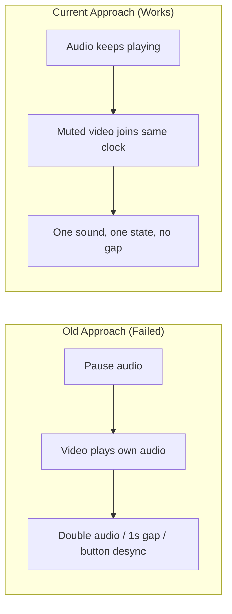

# Architectural Decisions, Pivots & Landmines (`DECISIONS_AND_TRAPS.md`)
> **1-Line Summary:** Records why we chose specific approaches, what failed when we tried other ways, who made the decision, and critical code traps never to touch.

## 1. Architectural Decisions & Pivot History

### [DECISION: Linked-Muted-Video-With-Master-Audio] | Aliases: video mode, double audio, video stops audio keeps playing, A/V sync
> **1-Line Summary:** Video mode plays the audio file as the only sound source while a muted video follows its clock, replacing the old pause-audio-play-video design that caused double audio and desync.
* **Decision Maker:** `[DECIDED BY: HUMAN]` (user: "I want audio and video linked... download the video without its audio")
* **Original User Intention:** One linked A/V experience where the play button, video and audio always agree, and switching modes has no delay.
* **Options Considered:**
  * **Option A (Rejected):** Pause the audio element and let the video play its own merged audio track. This caused double audio whenever both surfaces ran, a ~1s gap from the crossfade and stream resolution, stale late pause events flipping the button, and shared-clock drift.
  * **Option B (Chosen):** Audio stays the master clock and only sound source; the video element is muted and slave-synced (drift corrected above 0.75s). Video-only media makes this the natural model.
* **Visual Pivot Map (What Failed vs. What Works):**

* **Code Anchors (Grep Targets):**
  * `src/renderer/components/lyric/MusicFull.vue` -> `enterVideoMode`, `syncVideoSlaveState`
  * `src/renderer/store/modules/playerCore.ts` -> `setPlaybackMode`

### [DECISION: Video-Only-Media-By-Default] | Aliases: bestvideo, no audio merge, video -audio, smaller files
> **1-Line Summary:** Videos are streamed and downloaded without an audio track at all, since linked playback supplies the sound from the song file.
* **Decision Maker:** `[DECIDED BY: HUMAN]` (user suggestion: "download the video without its audio (video-only)")
* **Original User Intention:** No duplicated audio in files, smaller downloads, and a video file that matches how playback actually works.
* **Options Considered:**
  * **Option A (Rejected):** `bestvideo+bestaudio` merged by yt-dlp/ffmpeg, plus the ffmpeg DASH mux proxy for streaming. Duplicated audio in every file, and the proxy stream was unseekable.
  * **Option B (Chosen):** `-f bestvideo` / exact `formatId` with no merge; streams return the video-only URL directly (range-seekable). The mux proxy survives only as a legacy seek fallback.
* **Code Anchors (Grep Targets):**
  * `src/main/modules/youtube.ts` -> `downloadMedia`, `getStreamUrl`
  * `src/renderer/components/player/VideoSourcePopover.vue` -> `downloadVideoQuality`

### [DECISION: Per-Song-Media-Reset] | Aliases: next song stale video, artwork carries over, mode pill bug
> **1-Line Summary:** All media state is dropped on track change because video/artwork/quality belong to a song ID, never to the session.
* **Decision Maker:** `[DECIDED BY: HUMAN]` (bug report: "after pressing next... the old artwork and video stay")
* **Original User Intention:** A new song must start visually fresh, even when it has no video.
* **Options Considered:**
  * **Option A (Rejected):** Lazy overwriting of video state only when the new song has its own video. Left stale frames and a wrong pill whenever the next song was audio-only.
  * **Option B (Chosen):** Synchronous reset in `playTrack` plus a full local reset in the fullscreen player on song-ID change.
* **Code Anchors (Grep Targets):**
  * `src/renderer/services/playbackController.ts` -> `playTrack`
  * `src/renderer/store/modules/playerCore.ts` -> `resetMediaStateForNewSong`

### [DECISION: One-Writer-For-Play-State] | Aliases: play button desync, isPlay drift, three flags
> **1-Line Summary:** The play flag has one writer and pause stops every surface, instead of audio, video and MV each flipping it independently.
* **Decision Maker:** `[DECIDED BY: AGENT - Approved by Human]`
* **Original User Intention:** The button must never disagree with what is audible.
* **Options Considered:**
  * **Option A (Rejected):** Each media surface set the shared flag from its own events. Late crossfade pauses and video pauses overwrote each other and the button drifted from reality.
  * **Option B (Chosen):** Audio events own the flag (with guards for other surfaces), all buttons route through one toggle path, and `handlePause` pauses every registered element.
* **Code Anchors (Grep Targets):**
  * `src/renderer/store/modules/playerCore.ts` -> `setIsPlay`, `handlePause`
  * `src/renderer/hooks/usePlaybackControl.ts` -> `playMusicEvent`

### [DECISION: Lazy-IndexedDB-Proxy] | Aliases: white screen, top level await, startup crash
> **1-Line Summary:** The Dexie library handle is a lazy proxy so bundled module evaluation order can never crash startup again.
* **Decision Maker:** `[DECIDED BY: AGENT - Approved by Human]`
* **Original User Intention:** The packaged app must never open to a white screen.
* **Options Considered:**
  * **Option A (Rejected):** Top-level `await useIndexedDB(...)` at module root. Bundle chunk hoisting called `musicDB` before initialization (`ReferenceError`), crashing the renderer on packaged startup.
  * **Option B (Chosen):** Export a lazy proxy whose methods await an internal singleton, with guards for headless tests.
* **Code Anchors (Grep Targets):**
  * `src/renderer/hooks/IndexDBHook.ts` -> `musicDB`, `getMusicDBInstance`

### [DECISION: Single-FFmpeg-Binary] | Aliases: duplicate ffmpeg, 79 MB, packaging size
> **1-Line Summary:** Exactly one ffmpeg copy ships and one resolver points to it, cutting 79 MB from the portable.
* **Decision Maker:** `[DECIDED BY: AGENT - Approved by Human]`
* **Original User Intention:** A smaller portable without losing tag writing or video muxing.
* **Options Considered:**
  * **Option A (Rejected):** Let `tagAndMetadataManager` use the `ffmpeg-static` npm copy while `youtube.ts` used `resources/bin/ffmpeg.exe`. Two identical 79 MB binaries shipped.
  * **Option B (Chosen):** Both callers resolve through `getFfmpegPath()` in `youtube.ts`; `ffmpeg-static` removed entirely.
* **Code Anchors (Grep Targets):**
  * `src/main/modules/youtube.ts` -> `getFfmpegPath`

### [DECISION: English-Only-Source-With-Documented-Exemptions] | Aliases: de-china, chinese comments, sweep gate
> **1-Line Summary:** All source text and comments are English, with four deliberate CJK data exemptions and a regression gate.
* **Decision Maker:** `[DECIDED BY: HUMAN]` (requirement from the rebrand)
* **Original User Intention:** A clean English-first codebase and UI.
* **Options Considered:**
  * **Option A (Rejected):** Blanket-delete every CJK character. This destroyed romanisation lookup tables and broke the multilingual playlist importer.
  * **Option B (Chosen):** Translate real source text, keep transliteration tables, locale bundles, the playlist-header matcher and the font-preview sample, proven by `.sweep-gate.mjs`.
* **Code Anchors (Grep Targets):**
  * `.sweep-gate.mjs` -> gate script
  * `src/shared/transliteration.ts` -> `detectScriptAndRomanize`, `generateRomanizedLyricLrc`

### [DECISION: PolyForm-Noncommercial-Licensing] | Aliases: license, third party notices, mit upstream
> **1-Line Summary:** The project ships under PolyForm Noncommercial 1.0.0 with all upstream MIT/Apache credits kept in `THIRD_PARTY_NOTICES.md`.
* **Decision Maker:** `[DECIDED BY: HUMAN]` (user preference)
* **Original User Intention:** Noncommercial protection for this project while honoring upstream open-source licenses.
* **Options Considered:**
  * **Option A (Rejected):** Plain MIT for everything. The user wants noncommercial terms for their own work.
  * **Option B (Chosen):** `LICENSE` is strictly PolyForm Noncommercial 1.0.0; upstream MIT portions (AlgerMusicPlayer base, YesPlayMusic ports, all bundled libraries) are credited with license links in `THIRD_PARTY_NOTICES.md`.
* **Code Anchors (Grep Targets):**
  * `LICENSE` -> PolyForm Noncommercial 1.0.0
  * `THIRD_PARTY_NOTICES.md` -> credit tables

---

## 2. Do-Not-Touch Engineering Landmines (Traps)

### [TRAP: Never-Reintroduce-A-Second-FFmpeg] | Aliases: ffmpeg-static, duplicate binary, size regression
> **1-Line Summary:** NEVER add `ffmpeg-static` or an `asarUnpack` entry for ffmpeg — it silently doubles the download by 79 MB.
* **Strict Rule:** **NEVER** reintroduce `ffmpeg-static` as a dependency or unpack a second ffmpeg copy.
* **Why This Trap Exists (Plain English):** Both the tag writer and the video pipeline reach ffmpeg through the single `getFfmpegPath()` resolver. A second copy is invisible at runtime — everything still works — but the artifact balloons.
* **Protected Code Anchors (Grep Targets):**
  * `src/main/modules/youtube.ts` -> `getFfmpegPath`

### [TRAP: Muted-Linked-Video-Must-Never-Claim-Playback] | Aliases: coordinator, exclusivity, video pauses audio
> **1-Line Summary:** NEVER let the muted linked video register as an audible surface, or it will pause the very audio it follows.
* **Strict Rule:** **NEVER** remove the muted-element skip in the media coordinator's global play listener or claim exclusivity from `enterVideoMode`.
* **Why This Trap Exists (Plain English):** The coordinator pauses every other element when one plays. The linked video plays on purpose alongside its audio; if it ever claims ownership, the audio gets paused and playback dies.
* **Protected Code Anchors (Grep Targets):**
  * `src/renderer/services/mediaCoordinator.ts` -> `initGlobalDOMListener`, `toggleActiveNonAudioPlayback`
  * `src/renderer/components/lyric/MusicFull.vue` -> `syncVideoSlaveState`

### [TRAP: Cancel-Fade-Pauses-On-Resume] | Aliases: play then instant pause, button desync, 200ms ghost pause
> **1-Line Summary:** NEVER resume audio without cancelling the pending fade-out pause, or it fires 200ms later and silently stops the sound.
* **Strict Rule:** **NEVER** remove the `cancelFadeTimer()` call from the resume path of `play()`.
* **Why This Trap Exists (Plain English):** `pause(true)` schedules the real pause after a 200ms volume fade. A quick pause→play leaves that timer alive; without cancellation it pauses the freshly resumed audio and the button shows "playing" while nothing is audible.
* **Protected Code Anchors (Grep Targets):**
  * `src/renderer/services/audioService.ts` -> `play`, `cancelFadeTimer`

### [TRAP: Lyric-Start-Times-Are-Milliseconds] | Aliases: lrc times wrong, 1000x offset, saved lrc corrupted
> **1-Line Summary:** NEVER treat `ILyricText.startTime` as seconds — it is milliseconds and only `lrcTimeArray` is in seconds.
* **Strict Rule:** **NEVER** serialize or compare `startTime` without dividing/multiplying by 1000 explicitly.
* **Why This Trap Exists (Plain English):** Mixing the two units once already corrupted every exported `.lrc` file (mm:ss written from millisecond values). The parser, the editor and the exporter must all agree on the conversion.
* **Protected Code Anchors (Grep Targets):**
  * `src/renderer/components/lyric/MusicFull.vue` -> `rawLrcString`, `handleApplyEditedLrc`
  * `src/renderer/hooks/usePlayerHooks.ts` -> `loadLrc`

### [TRAP: Keep-Stored-Media-URLs-As-Local-Scheme] | Aliases: local://, seek broken, url conversion
> **1-Line Summary:** NEVER store playable http URLs in the library — keep `local://` and convert only at playback time.
* **Strict Rule:** **NEVER** persist `toPlayableMediaUrl()` output; always store the `local://` form.
* **Why This Trap Exists (Plain English):** Local-track identity checks, variant matching and rename tracking key off the `local://` form. Loopback URLs change and break matching; Chromium also cannot seek custom schemes, so conversion must happen at load time only.
* **Protected Code Anchors (Grep Targets):**
  * `src/renderer/utils/localMediaUrl.ts` -> `toPlayableMediaUrl`
  * `src/renderer/utils/persistedSong.ts` -> `minifySong`

### [TRAP: Dexie-Schema-Index-Versioning] | Aliases: schema version, indexeddb upgrade, variants table
> **1-Line Summary:** NEVER add or change a Dexie index without bumping the schema version, or upgrades corrupt existing libraries.
* **Strict Rule:** **NEVER** alter index declarations in `getLibraryDB()` without a new version block. (Plain field additions like `codec` are safe.)
* **Why This Trap Exists (Plain English):** IndexedDB only rebuilds indexes during an explicit version upgrade; a silent index change makes old libraries fail to open.
* **Protected Code Anchors (Grep Targets):**
  * `src/renderer/services/songLibrary.ts` -> `getLibraryDB`

### [TRAP: Comment-Sweeps-Must-Rewrite-Catch-Comments] | Aliases: empty catch, no-empty, silent errors
> **1-Line Summary:** NEVER mechanically delete comments from `catch { // reason }` blocks — rewrite them in English instead.
* **Strict Rule:** **NEVER** run a comment-removal pass without the `npx eslint ./src` `no-empty` check afterwards (count must stay 0).
* **Why This Trap Exists (Plain English):** Deleting the comment leaves an empty catch, which trips `no-empty`, fails CI, and silently discards the reason an error is ignored. One sweep already produced 13 such blocks.
* **Protected Code Anchors (Grep Targets):**
  * `.sweep-gate.mjs` -> regression gate
  * `eslint.config.mjs` -> `no-empty` rule

### [TRAP: Keep-Only-The-En-US-Locale-Pak] | Aliases: electronLanguages, locale paks, 44 MB bloat
> **1-Line Summary:** NEVER add a locale to `build.electronLanguages` without also shipping its language bundle — and never ship bundles without matching paks.
* **Strict Rule:** **NEVER** widen `electronLanguages` past `['en-US']` unless `src/i18n/lang/` actually ships that locale.
* **Why This Trap Exists (Plain English):** Chromium copies one ~800KB pak per listed language; 54 unused paks once added 44 MB to the artifact, and a listed-but-missing pak breaks startup strings.
* **Protected Code Anchors (Grep Targets):**
  * `package.json` -> `build.electronLanguages`

### [TRAP: Sandbox-Cannot-Launch-The-GUI] | Aliases: app exits immediately, bad option, headless
> **1-Line Summary:** NEVER treat "the packaged app exits instantly" as a regression in the agent sandbox — the GUI cannot open here.
* **Strict Rule:** **NEVER** chase startup-exit behavior from the agent shell; verify packaging changes by static artifact inspection instead.
* **Why This Trap Exists (Plain English):** The sandbox's Electron stub resolves `require('electron')` to the npm stub, so `app.whenReady()` never fires and the process exits 0 looking broken. Real verification needs a desktop session.
* **Protected Code Anchors (Grep Targets):**
  * `docs/ARCHITECTURE.md` -> `Automated-Check-Suite` (verification commands)
