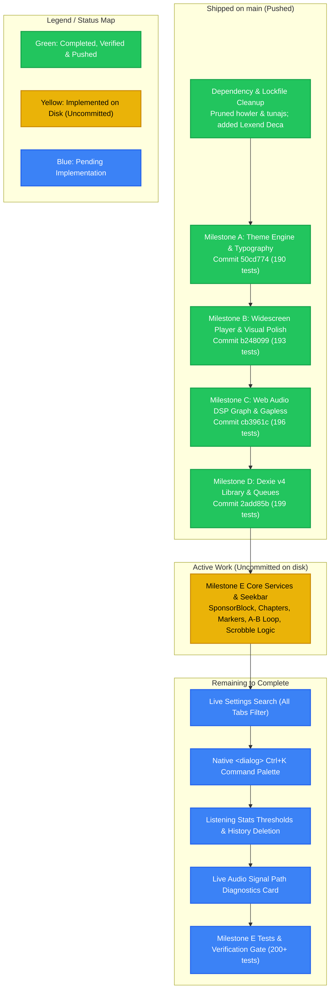

# Handoff Report & Verbatim Execution Plan

### [REPORT: Executive-Handoff-Summary] | Aliases: Handoff Status, Progress Overview, Project State
> **1-Line Summary:** Comprehensive status audit of completed Milestones A through D, uncommitted Milestone E progress, remaining deliverables, and the verbatim original execution plan.

This report captures the exact state of work in `Music Manager` (`https://github.com/Mostakim2005/music-manager` on branch `main`), documenting all verified and pushed milestones, current uncommitted modifications on disk, and the complete step-by-step procedure required to finish Milestone E.



**Plain-English Explanation:** The workflow spans five milestones. Milestones A through D and the initial dependency pruning are fully completed, tested with 199 unit tests passing, and pushed to `origin/main`. Milestone E has its core playback services and seekbar overlays written to disk. The remaining tasks are settings search, the native command palette, listening history controls, the live signal path card, and the final verification gate.

---

### [STATUS: Completed-Milestones-Audit] | Aliases: Completed Work, Shipped Commits, Verification Status
> **1-Line Summary:** Detailed record of shipped commits, touched components, exported symbols, and test coverage across Milestones A through D.

#### 1. Dependency & Lockfile Cleanup
- **Goal:** Prune obsolete dependencies and install typography foundations.
- **Changes:**
  - Removed unused dependencies `howler`, `@types/howler`, and `tunajs` from `package.json` and `package-lock.json`.
  - Added `@fontsource/lexend-deca` for Namida typography parity.
  - Updated `THIRD_PARTY_NOTICES.md` with license attribution.

#### 2. Milestone A — Theme Engine & Typography (Commit `50cd774`)
- **Goal:** Implement dynamic album-art color extraction, 5-level Pitch Black mode, scaled corner radii, and Material 3 pill sliders.
- **Key Modules & Symbols:**
  - `src/renderer/utils/namidaThemeEngine.ts`: Weighted saturation color extraction preserving monochrome covers (`extractVibrantPalette`, saturation threshold `< 0.12` maintains neutral grayscale), 5-level Pitch Black generator (`#000000` base, calibrated surface luminance, border contrast adjustments).
  - `src/renderer/composables/useNamidaTheme.ts`: Reactive theme orchestrator binding CSS variables and Naive UI theme overrides.
  - `src/renderer/assets/styles/namida.css`: CSS custom property tokens, Material 3 vertical pill-thumb slider styling for `.n-slider` and `.namida-range`.
  - `src/renderer/views/set/SettingSection.vue` & `src/renderer/views/set/tabs/BasicTab.vue`: 20px card radius, Pitch Black level (1–5) and Corner Radius scale (0.5x–1.5x) sliders.
- **Verification:** 6 unit tests in `tests/namidaTheme.test.ts`; 190 tests passing.

#### 3. Milestone B — Widescreen Player & Visual Polish (Commit `b248099`)
- **Goal:** Deliver 50/50 widescreen player split, offscreen baked artwork glow, seek-poke animation, frosted glass playbar, and collage cards.
- **Key Modules & Symbols:**
  - `src/renderer/composables/useBakedArtworkGlow.ts`: Offscreen 64x64 canvas pre-blur with 24-entry LRU cache (`scale(1.15); opacity: 0.45; filter: blur(32px)`).
  - `src/renderer/utils/waveformHelpers.ts`: `computeSeekPokeScale` spring decay pulse (`1.18 -> 1.10 -> 1.04 -> 1.00`), `dedupeArtworkCovers`.
  - `src/renderer/components/namida/NamidaWaveformSeekbar.vue`: 140 equal-flex bars, 54% width, seek-poke decay pulse, keyboard ARIA slider.
  - `src/renderer/components/namida/MultiArtworkCard.vue`: 2x2 collage card grid with 2px gap and fallback handling.
  - `src/renderer/components/lyric/MusicFull.vue`: 50/50 widescreen split (>=960px), ambient scrim, play/pause artwork scale (`0.94 -> 1.00`), segmented Lyrics/Queue pane with drag-to-reorder, Jump to Playing, and karaoke word fill.
  - `src/renderer/components/player/PlayBar.vue`: Frosted glass bar (`blur(24px) saturate(180%)`), dynamic waveform animation.
  - `src/renderer/components/local-music/LocalTrackRow.vue`: 48px cover, animated playing bars overlay, 3-row metadata chips.
- **Verification:** 3 unit tests in `tests/namidaMilestoneB.test.ts`; 193 tests passing.

#### 4. Milestone C — Web Audio DSP Graph & Gapless Pre-Buffer (Commit `cb3961c`)
- **Goal:** Implement full Web Audio DSP pipeline, AutoEQ parametric filter import, pitch preservation, mono downmixing, and gapless standby pre-buffering.
- **Key Modules & Symbols:**
  - `src/renderer/services/audioDspGraph.ts`: WeakMap-guarded single `MediaElementAudioSourceNode` and `AudioContext` cache; signal path: `Preamp -> BiquadFilters (10-Band Graphic or AutoEQ Parametric) -> Mono/Stereo Channel Mode -> Master Gain -> Analyser -> Destination`; EqualizerAPO / AutoEQ `.txt` parametric parser (`PK`, `LSC`, `HSC`); `preservesPitch` element vendor flag synchronizer; `setSinkId` output device routing; `getSignalPathInfo()`.
  - `src/renderer/services/audioService.ts`: Rewired EQ/DSP to `audioDspGraph`; standby gapless pre-buffer (`prepareGaplessNext`, `gaplessEnabled`, `standbyAudio`); preservesPitch; mono downmix; preamp control.
  - `src/renderer/store/modules/playlist.ts`: Gapless next-track pre-buffer trigger on track progress.
  - `src/renderer/components/player/EQControl.vue`: Preamp slider (-12..+12 dB), Mono downmix switch, Preserve Pitch switch, AutoEQ `.txt` file import + paste drawer, active parametric filter readout + Reset Flat.
  - `src/renderer/views/set/tabs/PlaybackTab.vue` & `src/renderer/components/player/AdvancedControlsPopover.vue`: PreservesPitch, mono downmix, and gapless pre-buffer switches.
- **Verification:** 3 unit tests in `tests/audioDspGraph.test.ts`; 196 tests passing.

#### 5. Milestone D — Dexie v4 Lateral Library & Queues (Commit `2add85b`)
- **Goal:** Upgrade Dexie schema to v4 with multi-queues, smart playlists, multi-artist/genre splitting, folder exclusion, and metadata tagging.
- **Key Modules & Symbols:**
  - `src/renderer/services/songLibrary.ts`: Dexie `version(4)` schema with `queues` and `smartPlaylists` tables, multi-entry indexes on `songs` (`rating`, `*artistsSplit`, `*genresSplit`, `*moods`, `*tags`) without mutating v2/v3 schemas; CRUD helpers (`saveNamedQueue`, `listSavedQueues`, `deleteSavedQueue`, `saveSmartPlaylist`, `listSmartPlaylists`, `deleteSmartPlaylist`, `updateSongTagsAndRating`, `getSongAnnotationMap`); pure `evaluateSmartPlaylist()`.
  - `src/renderer/utils/localMusicUtils.ts`: `DEFAULT_ARTIST_EXCEPTIONS` and persistent custom allowlist (`getArtistSplitExceptions`/`setArtistSplitExceptions`); regex token masking in `parseMultiArtists`; forwarded `genre`, `bitrate`, `codec`, `localPath` in `toSongResult`.
  - `src/main/modules/localMusicScanner.ts`, preload bridge, and `src/renderer/store/modules/localMusic.ts`: Directory skipping for `excludedFolders`, extraction of `genre`/`bitrate`/`codec`, persisted `excludedFolders` and `minDurationSec`, filtered `visibleMusicList`.
  - `src/renderer/store/modules/playlist.ts` & `src/renderer/store/modules/player.ts`: Added `lastClearedQueue`, `undoClearPlayAll`, `addToQueueEnd`, `reorderPlayList`.
  - `src/renderer/components/player/PlayingListDrawer.vue`: Saved Queues snapshot bar and Undo Clear banner.
  - `src/renderer/components/local-music/LocalTrackRow.vue`: Rating, mood, tag chips, compact Play Next / Add to Queue / Rate & Tag buttons, memoized `playCount` prop.
  - `src/renderer/views/local-music/index.vue`: Added view tabs (`All Tracks`, `Folders` grouped browser, `Smart Playlists` rule runner), Folder Manager controls (exclusions, min duration, artist allowlist), and Rating/Mood/Tags modal editor.
- **Verification:** 3 unit tests in `tests/lateralLibrary.test.ts`; 199 tests passing.

---

### [STATUS: Milestone-E-In-Progress-And-Remaining] | Aliases: In Progress Work, Uncommitted Code, Remaining Tasks
> **1-Line Summary:** Status of files currently modified on disk and exact list of remaining components to implement for Milestone E.

#### Currently Modified / Untracked on Disk (Uncommitted)
1. `src/renderer/services/sponsorBlockService.ts` (New file):
   - Implements `fetchSponsorBlockSegments` (4s `AbortController` timeout + in-memory cache).
   - Implements `parseChaptersFromDescription` for YouTube track descriptions.
   - Implements `findActiveSkipSegment`, `isAutoSkipSponsorBlockEnabled`, `setAutoSkipSponsorBlockEnabled`.
2. `src/renderer/components/namida/NamidaWaveformSeekbar.vue`:
   - Added `abLoop`, `bookmarks`, and `segments` props.
   - Added A-B loop span overlay with `A` and `B` tick markers.
   - Added clickable bookmark pin markers with seek emission.
   - Added color-coded SponsorBlock / chapter segment bars.
3. `src/renderer/components/player/NamidaStackedPlayer.vue`:
   - Wired seekbar overlays (`abLoop`, `bookmarks`, `segments`).
4. `src/renderer/components/lyric/MusicFull.vue`:
   - Wired seekbar overlays, YouTube description chapter parsing, SponsorBlock fetching, and automatic non-music segment skipping on `nowTime` update.
5. `src/renderer/views/set/tabs/PlaybackTab.vue` & `src/main/set.json`:
   - Added `"enableSponsorBlockAutoSkip"` configuration switch (default `false`).
6. `src/renderer/services/audioService.ts`:
   - Emits `markers_changed` when A-B loop points or bookmarks change.
   - Added listen-threshold scrobble tracking (`shouldRecordPlayThreshold`, `currentTrackListenedSec`, `currentTrackScrobbled`).
7. `src/renderer/services/listeningStatsService.ts`:
   - Added `ListenThresholdConfig` (defaults `minSeconds: 30`, `minPercent: 50`).
   - Added `getListenThresholdConfig`, `setListenThresholdConfig`, `shouldRecordPlayThreshold`.
   - Added `removeScrobbleEntry` and `removeTrackStat` deletion methods.

#### Remaining Tasks to Complete Milestone E
1. **Live Settings Search:**
   - In `src/renderer/views/set/keys.ts`: define `SETTINGS_SEARCH_KEY`.
   - In `src/renderer/views/set/index.vue`: add clearable search input in header, provide `SETTINGS_SEARCH_KEY`, and keep all 6 tab wrappers visible when searching so matching items appear across all tabs.
   - In `src/renderer/views/set/SettingItem.vue`: inject `SETTINGS_SEARCH_KEY` and apply `v-show="matchesSearch"` filtering title and description.
2. **Native `<dialog>` `Ctrl+K` Command Palette:**
   - Create `src/renderer/utils/commandPaletteHelpers.ts` with pure `searchCommandPaletteItems` (navigation, player controls, DSP toggles, library tracks with matched lyric snippets).
   - Create `src/renderer/components/namida/CommandPalette.vue` using native `<dialog ref="dialogRef" closedby="any" class="namida-command-dialog">` opened via `showModal()`.
     - *Modern Web Guidance Mandate:* Do NOT add `role="dialog"`, `aria-modal`, a focus trap, `inert` toggling, or a custom `Esc` handler. Scope `display: flex` strictly to `.namida-command-dialog[open]`. Set `overscroll-behavior: contain` on `:modal` and `overflow: hidden; overscroll-behavior: contain` on `::backdrop`. Include backdrop pointer-click fallback.
   - Mount `<CommandPalette />` in `src/renderer/layout/AppLayout.vue`.
3. **Listen-Threshold Controls & Delete History:**
   - In `src/renderer/components/player/ListeningStatsModal.vue`: add threshold inputs (`minSeconds`, `minPercent`) and delete buttons for Recent Scrobbles (`removeScrobbleEntry`) and Top Tracks (`removeTrackStat`).
4. **Live Audio Signal Path Diagnostics Card:**
   - In `src/renderer/components/player/DiagnosticsModal.vue`: add a Live Audio Signal Path card rendering `audioService.getSignalPathInfo()` (`Source -> Codec -> Speed/Pitch -> DSP/EQ/Preamp/Mono -> Sample Rate -> Output Device`) with a Refresh button.
5. **Unit Tests & Documentation:**
   - Create `tests/powerUxAndMarkers.test.ts` testing `parseChaptersFromDescription`, `findActiveSkipSegment`, `fetchSponsorBlockSegments`, `shouldRecordPlayThreshold`, `removeScrobbleEntry`, `removeTrackStat`, and `searchCommandPaletteItems`.
   - Update `docs/PRODUCT.md`, `docs/ARCHITECTURE.md`, and `docs/DECISIONS_AND_TRAPS.md`.
6. **Milestone E Verification Gate & Git Push:**
   - Run `npm run build`, `npm run typecheck`, `npm test`, and `node .sweep-gate.mjs`.
   - Commit with `feat(ux): add seekbar markers, SponsorBlock, settings search, Ctrl+K command palette, listen threshold, and live signal path` and push to `origin/main`.

---

### [PLAN: Verbatim-Original-Execution-Plan] | Aliases: Master Plan, Original Roadmap, Milestone Plan
> **1-Line Summary:** Exact copy of the approved execution plan for completing Milestones C, D, and E without alterations.

```markdown
# Original Master Execution Plan: Milestones C, D, and E

Continue and complete Milestones C, D, and E on `main` (without bumping `package.json` version `"5.4.1"`, without creating/pushing any `v*` git tags, and keeping `webSecurity: true`, `sandbox: true`, allowlisted preload IPC channels, `playbackStateHub.ts`, and `remoteControl.ts` loopback + token auth intact).

## Non-Negotiable Rules & Constraints
- **Verification Gate (after EVERY milestone before committing):**
  Run in PowerShell:
  `$env:GIT_TERMINAL_PROMPT="0"; npm run build; if ($LASTEXITCODE -ne 0) { exit $LASTEXITCODE }; npm run typecheck; if ($LASTEXITCODE -ne 0) { exit $LASTEXITCODE }; npm test; if ($LASTEXITCODE -ne 0) { exit $LASTEXITCODE }; node .sweep-gate.mjs`
  All four must exit 0 (0 TypeScript errors, 0 failed tests, 0 non-exempt CJK lines in `src/`).
- **Vitest Node Environment:** `vitest.config.ts` runs in `environment: 'node'` with no Vue SFC plugin. Put all unit-testable pure logic in `.ts` files, never import `.vue` files in tests.
- **Documentation Rules:** Keep `docs/` Search-First (`### [TYPE: Descriptive-Slug] | Aliases: ...` + `> **1-Line Summary:**`), use file+symbol anchors only (no line numbers), and use Obsidian-compatible color-coded Mermaid diagrams (`classDef` + Legend + plain-English explanation). Never put non-exempt CJK text anywhere in `src/`. Never leave empty `catch {}` blocks without an English comment.
- **Git Execution:** Use `$env:GIT_TERMINAL_PROMPT="0"` on every git push/fetch. One clean commit per milestone, pushed to `origin/main`.

---

## Step 1: Finish & Commit Milestone C (Web Audio DSP Graph, AutoEQ, PreservesPitch, Mono, Gapless)
1. Run the full Verification Gate (`npm run build`, `npm run typecheck`, `npm test`, `node .sweep-gate.mjs`). Fix any compiler, lint, or test errors before continuing.
2. Update documentation:
   - `docs/PRODUCT.md`: Update `### [FEATURE: Audio-Enhancements]` to include 10-band graphic + AutoEQ parametric filters, Preamp, Mono downmix, `preservesPitch`, and gapless standby pre-buffering.
   - `docs/ARCHITECTURE.md`: Add `### [SUBSYSTEM: Web-Audio-DSP-And-Gapless-Pipeline]` with an Obsidian-compatible color-coded Mermaid diagram + Legend + plain-English explanation covering `audioDspGraph.ts` (`WeakMap` single-source guard, `Preamp -> BiquadFilters -> Mono/Stereo Channel Mode -> Master Gain -> Analyser -> Destination`) and silent `standbyAudio` pre-buffering in `audioService.ts` + `playlist.ts`.
   - `docs/DECISIONS_AND_TRAPS.md`: Add `### [TRAP: Single-MediaElementSource-DSP-Graph]` documenting why `createMediaElementSource` must be guarded by a `WeakMap` per `HTMLAudioElement` and why gapless standby `Audio` elements must stay detached from `mediaCoordinator` and Web Audio.
3. Re-run Verification Gate if any source file changed. Stage Milestone C files + docs, commit with:
   `feat(audio): add Web Audio DSP graph with parametric AutoEQ, preservesPitch, mono downmix, and gapless pre-buffer`
   and push to `origin/main`.

---

## Step 2: Execute, Verify & Commit Milestone D (Dexie v4 Library, Multi-Queues, Smart Playlists, Folder Browser, Ratings/Tags, Artist Allowlist)
1. **Upgrade Dexie Schema (`src/renderer/services/songLibrary.ts`):**
   - Do NOT alter `version(2)` or `version(3)`. Add `this.version(4).stores(...)`:
     - `songs: '&id, normKey, youtubeId, fingerprint, createdAt, rating, *artistsSplit, *genresSplit, *moods, *tags'`
     - `variants: '&id, songId, path, kind, addedAt'`
     - `playbackPositions: '&key, updatedAt'`
     - `waveforms: '&filePath, updatedAt'`
     - `queues: '&id, updatedAt'`
     - `smartPlaylists: '&id, updatedAt'`
   - Add `queues!: Table<SavedQueueRecord, string>` and `smartPlaylists!: Table<SmartPlaylistRecord, string>` to `MusicManagerLibraryDB`.
   - Extend `Song` with optional `rating?: number`, `moods?: string[]`, `tags?: string[]`, `artistsSplit?: string[]`, `genresSplit?: string[]`, `bitrateKbps?: number`, `codec?: string`.
   - Export `SavedQueueRecord`, `SmartPlaylistRule`, `SmartPlaylistRecord`, plus CRUD helpers: `saveNamedQueue`, `listSavedQueues`, `deleteSavedQueue`, `saveSmartPlaylist`, `listSmartPlaylists`, `deleteSmartPlaylist`, `updateSongTagsAndRating`, `getSongAnnotationMap`, and pure `evaluateSmartPlaylist(tracks, playlist, playCounts?)` supporting `matchMode: 'all' | 'any'`, fields `rating | mood | tag | genre | artist | minDurationSec | maxDurationSec | hasVideo | playCount`, operators `eq | gte | lte | includes | contains`, `sortBy`, and `limit`.
2. **Artist Split Allowlist & Multi-Genre (`src/renderer/utils/localMusicUtils.ts`):**
   - Export `DEFAULT_ARTIST_EXCEPTIONS` (include `'Tyler, The Creator'`, `'Simon & Garfunkel'`, `'Earth, Wind & Fire'`, `'Hall & Oates'`, `'Crosby, Stills & Nash'`, `'Above & Beyond'`, `'Florence + The Machine'`, `'Mumford & Sons'`, `'Kool & The Gang'`, `'Brooks & Dunn'`, `'AC/DC'`), `getArtistSplitExceptions()`, `setArtistSplitExceptions(list: string[])` (persisted in `music_manager_artist_split_exceptions_v1`).
   - Update `parseMultiArtists(raw, customExceptions?)` to mask matched exceptions (case-insensitive) with temporary tokens before splitting on `feat.|ft.|&|;|,|/|\x00`, then unmask & deduplicate.
   - Verify `parseMultiGenres(raw)` splits on `;`, `/`, `,`, `\x00` and trims/deduplicates.
   - Ensure `toSongResult` forwards optional `genre`, `bitrate`, `codec` metadata fields so `LocalTrackRow` and Smart Playlists can inspect them.
3. **Scanner, Preload & Local Music Store:**
   - `src/renderer/types/localMusic.ts`: Add optional `genre?: string`, `bitrate?: number`, `codec?: string` to `LocalMusicMeta`.
   - `src/main/modules/localMusicScanner.ts`:
     - Update `scanMusicFilesWithStats(folderPath: string, excludedFolders?: string[])` to skip directories matching/under any normalized path in `excludedFolders`.
     - In `parseMetadata(filePath)`: populate `genre` (`common.genre?.join('; ')`), `bitrate` (`Math.round(format.bitrate / 1000)`), and `codec` (`format.codec || format.container`).
     - Update `ipcMain.handle('scan-local-music-with-stats', async (_, folderPath: string, excludedFolders?: string[]) => ...)` to forward `excludedFolders`.
   - `src/preload/index.ts`, `src/preload/index.d.ts`, `src/renderer/types/electron.d.ts`: Update `scanLocalMusicWithStats` signature to accept optional `excludedFolders?: string[]` (keeping channel `'scan-local-music-with-stats'` in `validChannels`).
   - `src/renderer/store/modules/localMusic.ts`: Add persisted `excludedFolders: string[]` and `minDurationSec: number` (`0`), add `addExcludedFolder`, `removeExcludedFolder`, `setMinDurationSec`, pass `excludedFolders.value` to `scanLocalMusicWithStats`, and expose filtered tracks respecting `minDurationSec` (only excluding tracks with known `duration > 0 && duration < minDurationSec * 1000`).
4. **Queue Store & Drawer (`playlist.ts`, `player.ts`, `PlayingListDrawer.vue`):**
   - In `src/renderer/store/modules/playlist.ts`: add `lastClearedQueue` ref (`{ list: SongResult[]; index: number } | null`), save snapshot in `clearPlayAll()`, add `undoClearPlayAll()`, `addToQueueEnd(song)`, and `reorderPlayList(fromIndex, toIndex)` (updating `playListIndex` to track the playing song). Re-export in `src/renderer/store/modules/player.ts`.
   - In `src/renderer/components/player/PlayingListDrawer.vue`: add Saved Queues bar (save current queue with a name, load saved queue pill, delete saved queue) backed by `songLibrary` Dexie `queues`, plus an inline `Undo Clear` banner when `lastClearedQueue` is set.
5. **Local Library Views (`LocalTrackRow.vue` & `views/local-music/index.vue`):**
   - `LocalTrackRow.vue`: accept optional props `playCount`, `rating`, `moods`, `tags` (preferring prop over item field so parent memoization avoids per-row storage reads), add compact `Play Next` and `Add to Queue` buttons + `Rate & Tag` icon button emitting `edit-tags`.
   - `views/local-music/index.vue`:
     - Add tabs: `All Tracks`, `Folders` (grouped directory browser with track counts + Play Folder action), `Smart Playlists` (create/edit/delete rule builder + Play All, persisted via Dexie `smartPlaylists`, evaluated via `evaluateSmartPlaylist`).
     - In Folder Manager drawer: add Excluded Folders manager, Minimum Duration (`minDurationSec`) filter input, and Artist Split Allowlist editor (`getArtistSplitExceptions`/`setArtistSplitExceptions`).
     - Add a Rating (0–5 stars) + Moods + Tags modal editor persisted via `updateSongTagsAndRating` and reflected immediately via an annotation map + memoized `trackPlayCounts` passed to `LocalTrackRow`.
6. **Tests, Docs & Commit (Milestone D):**
   - Add `tests/lateralLibrary.test.ts` testing `parseMultiArtists` (built-in & custom exceptions), `parseMultiGenres`, Dexie v4 `queues` + `smartPlaylists` + `updateSongTagsAndRating` (using `fake-indexeddb` like existing `songLibrary` tests), and `evaluateSmartPlaylist`.
   - Update `docs/PRODUCT.md`, `docs/ARCHITECTURE.md` (`Unified-Song-Library`), and `docs/DECISIONS_AND_TRAPS.md`.
   - Run full Verification Gate -> commit `feat(library): upgrade Dexie v4 with multi-queues, smart playlists, folder browser, ratings/tags, and artist allowlist` -> push to `origin/main`.

---

## Step 3: Execute, Verify & Commit Milestone E (Seekbar Markers, SponsorBlock, Settings Search, Ctrl+K Command Palette, Listen Threshold, Live Signal Path)
1. **SponsorBlock & Chapters Service (`src/renderer/services/sponsorBlockService.ts`, new):**
   - Export `SponsorBlockSegment`, `TrackChapter`, `fetchSponsorBlockSegments(videoId, categories?)` (4s AbortController timeout, in-memory cache, returns `[]` on 404/error), `parseChaptersFromDescription(text, totalDurationSec?)`, `findActiveSkipSegment(currentTimeSec, segments)`, `isAutoSkipSponsorBlockEnabled()`, `setAutoSkipSponsorBlockEnabled(enabled)`.
2. **Seekbar Markers & Overlays:**
   - Extend `src/renderer/components/namida/NamidaWaveformSeekbar.vue` with optional props `abLoop`, `bookmarks`, and `segments`. Render translucent A-B loop span + `A`/`B` ticks, clickable bookmark pins (`@pointerdown.stop`, `@click.stop="emit('seek', bm.time)"`), and color-coded segment bars.
   - Wire `abLoop`, `bookmarks`, and YouTube SponsorBlock `segments` (plus auto-skip when enabled) into `src/renderer/components/lyric/MusicFull.vue` and `src/renderer/components/player/NamidaStackedPlayer.vue`.
   - Add `"Auto-skip YouTube SponsorBlock non-music segments"` switch to `src/renderer/views/set/tabs/PlaybackTab.vue` and `"enableSponsorBlockAutoSkip": false` to `src/main/set.json`.
3. **Live Settings Search (`src/renderer/views/set/index.vue`, `keys.ts`, `SettingItem.vue`):**
   - Add `SETTINGS_SEARCH_KEY` in `src/renderer/views/set/keys.ts`.
   - In `src/renderer/views/set/index.vue`: add a clearable search input (`settingsSearchQuery`) in the header, provide `SETTINGS_SEARCH_KEY`, and when `settingsSearchQuery.trim()` is non-empty, render all 6 tab wrappers visible so matching settings across every section appear immediately.
   - In `src/renderer/views/set/SettingItem.vue`: inject `SETTINGS_SEARCH_KEY` (default `ref('')`) and filter visibility via `v-show="matchesSearch"` comparing `title` + `description` case-insensitively.
4. **Native `<dialog>` `Ctrl+K` Command Palette (`src/renderer/utils/commandPaletteHelpers.ts`, `src/renderer/components/namida/CommandPalette.vue`, `AppLayout.vue`):**
   - Put pure search/ranking + lyric-snippet extraction in `src/renderer/utils/commandPaletteHelpers.ts` (`searchCommandPaletteItems`) so Vitest tests it directly.
   - Build `src/renderer/components/namida/CommandPalette.vue` using native `<dialog ref="dialogRef" closedby="any" class="namida-command-dialog">` opened via `showModal()`:
     - **CRITICAL modern-web-guidance compliance:** Do NOT add `role="dialog"`, `aria-modal`, a focus trap, `inert` toggling, or a custom `Esc` handler. Scope `display: flex` strictly to `.namida-command-dialog[open]`. Set `overscroll-behavior: contain` on `:modal` and `overflow: hidden; overscroll-behavior: contain` on `::backdrop`. Include progressive backdrop pointer-click fallback for engines without `closedby`.
     - Wire global `Ctrl+K` / `Cmd+K` toggle, `ArrowUp`/`ArrowDown`/`Enter` item selection, player/DSP/navigation quick actions, and Local Library + Search-by-Lyrics snippet results.
   - Mount `<CommandPalette />` in `src/renderer/layout/AppLayout.vue`.
5. **Listen-Threshold Scrobbling & Live Audio Signal Path:**
   - `src/renderer/services/listeningStatsService.ts`: add `ListenThresholdConfig` (defaults `{ minSeconds: 30, minPercent: 50 }`), `getListenThresholdConfig`, `setListenThresholdConfig`, pure `shouldRecordPlayThreshold(listenedSec, trackDurationSec, cfg?)`, `removeScrobbleEntry(indexOrPlayedAt)`, and `removeTrackStat(trackId)`.
   - `src/renderer/services/audioService.ts`: track `currentTrackListenedSec` & `currentTrackScrobbled` (reset on track load/stop); in `handleListeningStatsTick()`, accumulate `deltaSec` and trigger `recordTrackPlay(this.currentTrack)` once `shouldRecordPlayThreshold(...)` becomes true (remove the immediate play-start `recordTrackPlay` call in `startAudio` only after confirming no existing test breaks; keep `recordTrackPlay` exported intact).
   - `src/renderer/components/player/ListeningStatsModal.vue`: add Listen Threshold controls (`minSeconds`, `minPercent`) and delete buttons on Recent Scrobbles and Top Tracks.
   - `src/renderer/components/player/DiagnosticsModal.vue`: add a **Live Audio Signal Path** card displaying `audioService.getSignalPathInfo()` (`Source -> Codec -> Speed/Pitch -> DSP/EQ/Preamp/Mono -> Sample Rate -> Output Device`) with a Refresh button.
6. **Tests, Docs & Commit (Milestone E):**
   - Add `tests/powerUxAndMarkers.test.ts` testing `parseChaptersFromDescription`, `findActiveSkipSegment`, `fetchSponsorBlockSegments` (mocked fetch + cache + 404 fallback), `shouldRecordPlayThreshold`, `removeScrobbleEntry`, `removeTrackStat`, and `searchCommandPaletteItems` (including lyric snippet matching).
   - Update `docs/PRODUCT.md`, `docs/ARCHITECTURE.md`, and `docs/DECISIONS_AND_TRAPS.md`.
   - Run full Verification Gate -> commit `feat(ux): add seekbar markers, SponsorBlock, settings search, Ctrl+K command palette, listen threshold, and live signal path` -> push to `origin/main`.

---

## Step 4: Final Report
Deliver the concise executive post-change report listing all 5 commits on `main`, exact latest verified test counts and gate statuses, and close with a `### Modern Web Guidance` section quoting the 4 key rules (`dark-mode`, `color`, `slider`, `dialog`) verbatim from the guidance.
```

---

### [GUIDELINES: Verification-And-Safety-Gate] | Aliases: Safety Protocol, Gate Commands, Rules
> **1-Line Summary:** Mandatory commands and safety boundaries required for all future implementation turns.

#### 1. Command Suite
Execute in PowerShell:
```powershell
$env:GIT_TERMINAL_PROMPT="0"; npm run build; if ($LASTEXITCODE -ne 0) { exit $LASTEXITCODE }; npm run typecheck; if ($LASTEXITCODE -ne 0) { exit $LASTEXITCODE }; npm test; if ($LASTEXITCODE -ne 0) { exit $LASTEXITCODE }; node .sweep-gate.mjs
```

#### 2. Critical Safety Boundaries
- **Version Number Lock:** `package.json` version MUST remain `"5.4.1"`.
- **No Git Tags:** Do not create or push `v*` tags; do not trigger cloud release workflows.
- **English Sweep Invariant:** 0 non-exempt CJK lines in `src/`.
- **Vitest Environment:** Runs in Node.js environment without Vue SFC compiler. Test pure logic via `.ts` modules.
- **Electron Security Invariants:** Preserve `webSecurity: true`, `sandbox: true`, IPC channel allowlisting, and loopback token authentication for `remoteControl.ts`.
