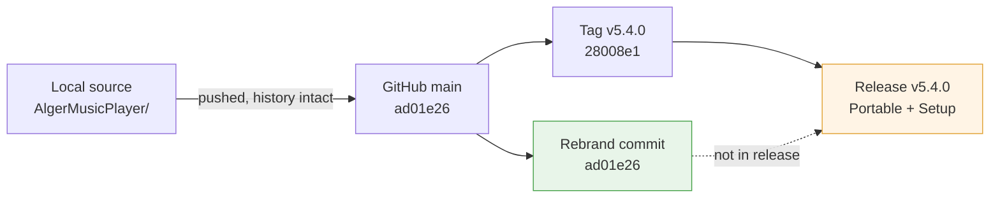

# Music Manager — Migration & Release Audit

**Audit date:** 7 November 2026, 10:10 (Asia/Dhaka)
**Auditor:** DSH coding agent
**Subject:** Local workspace → GitHub migration, plus new tag and release verification
**GitHub repo:** https://github.com/Mostakim2005/music-manager

---

## 1. Bottom line

**Yes — the migration is complete.** The code is fully on GitHub, publicly visible, with history intact, clean working trees on both sides, a governance/documentation suite, CI workflows, a PolyForm Noncommercial license, and upstream MIT credits.

**Yes — a new tag and release exist.** `v5.4.0` is tagged and published with two Windows binaries, and every build-quality gate in CI passed.

**But there is one real defect.** One commit landed *after* the tag was cut. That commit is the one that rebrands the app from the upstream author to you. Because it missed the release build, **the downloadable `v5.4.0` binaries still identify themselves as "Alger" and still check the upstream author's GitHub repo for updates.** So the migration is finished *in the repository*, but not finished *in the shipped product*.

**Verdict: 9 of 10 boxes ticked. One follow-up release recommended (v5.4.1).**

---

## 2. Scorecard

| # | Check | Result | Evidence |
|---|---|---|---|
| 1 | Local source pushed to GitHub | ✅ Pass | `main` @ `ad01e26`, 100+ commits, clean tree |
| 2 | Repo public & correctly named | ✅ Pass | `Mostakim2005/music-manager`, created 6 Nov 2026 |
| 3 | Commit history preserved | ✅ Pass | Full upstream ancestry kept, not squashed |
| 4 | Local and remote in sync | ✅ Pass | `main...origin/main` — no divergence |
| 5 | Docs suite migrated | ✅ Pass | `docs/` rebuilt + old set archived in `docs/legacy/` |
| 6 | Governance files | ✅ Pass | `LICENSE`, `THIRD_PARTY_NOTICES.md`, `UPSTREAM.md`, `README.md`, `CHANGELOG.md` |
| 7 | CI build workflow | ✅ Pass | Tag-triggered `Build Portable Release` + `PR Check` |
| 8 | New tag created | ✅ Pass | `v5.4.0` → `28008e1` |
| 9 | New release published with binaries | ⚠️ Partial | Published, but built from a commit *before* the rebrand |
| 10 | Working tree clean / no secrets leaked | ✅ Pass | `.env.development` intentionally whitelisted, localhost-only value |

---

## 3. What is genuinely finished

### 3.1 The repository
`https://github.com/Mostakim2005/music-manager` is a public, non-fork repo with the real source tree: `src/main`, `src/preload`, `src/renderer`, `src/shared`, `src/i18n`, plus `tests/`, `scripts/`, `resources/`, `android/`, and the Electron/Vite/TypeScript configuration.

### 3.2 The documentation migration
This was done properly rather than blindly. Your old workspace docs were **archived, not deleted**, and a fresh suite was written in their place:

| Old (local workspace) | New (on GitHub) |
|---|---|
| `docs/ARCHITECTURE.md` (22 KB) | `docs/ARCHITECTURE.md` (11 KB) + `docs/legacy/ARCHITECTURE.legacy.md` (22 KB) |
| `docs/FEATURES.md` (31 KB) | `docs/PRODUCT.md` (14 KB) + `docs/legacy/FEATURES.legacy.md` |
| `docs/BUGS.md` | `docs/legacy/BUGS.legacy.md` |
| `docs/REMOVED_FEATURES.md` | `docs/legacy/REMOVED_FEATURES.legacy.md` |
| `docs/INDEX.md` | `docs/legacy/INDEX.legacy.md` |
| `HANDOFF.md` | `docs/legacy/HANDOFF.md` |
| *(none)* | `docs/DECISIONS_AND_TRAPS.md` (new) |
| *(none)* | `docs/VISUAL_GUIDE.html` (new, with screenshots) |

Nothing was lost — every old file has a byte-identical legacy copy on GitHub.

### 3.3 The CI pipeline
The tag-triggered workflow ran and **all 15 steps passed**:

| Step | Result |
|---|---|
| Install dependencies | ✅ |
| Build bundle (generates type stubs) | ✅ |
| Type checks | ✅ |
| Unit tests | ✅ |
| English sweep gate | ✅ |
| Build portable `.exe` | ✅ |
| Build NSIS installer | ✅ |
| Attach to GitHub Release | ✅ |

Run ID `42180321408`, completed in 8m 29s. Two earlier failures on the same pipeline were diagnosed and fixed mid-migration (a missing type-stub generation step, and a deleted upstream web-deploy workflow).

### 3.4 The release
`v5.4.0`, published 6 November 2026 at 13:29 Dhaka time, marked latest, not a draft, not a prerelease.

| Asset | Size | Notes |
|---|---|---|
| `MusicManager-v5.4.0-Portable.exe` | 224.4 MB | Portable — matches your standing default |
| `MusicManager-v5.4.0-Setup.exe` | 238.1 MB | NSIS installer — shipped alongside |

Both carry published SHA-256 digests. No build binaries are committed to git history — the repo is only 35 MB, which is correct per your "clean modular source only" rule.

---

## 4. The one defect, explained plainly

Here is the timeline. Notice the two-hour gap:

| Time (Dhaka) | What happened |
|---|---|
| 6 Nov, 13:21 | Commit `28008e1` pushed → tag `v5.4.0` placed **here** |
| 6 Nov, 13:29 | Release `v5.4.0` published; binaries built from `28008e1` |
| 6 Nov, 15:35 | Commit `ad01e26` pushed → **the rebrand commit** |
| Now | `main` is at `ad01e26`, one commit ahead of the tag |

The rebrand commit `ad01e26` is exactly the work that makes the app *yours*. It changed 8 files, and every change is user-visible:

| File | What it changes | In the shipped `.exe`? |
|---|---|---|
| `package.json` | Author: `Alger <algerkc@qq.com>` → `Mostakim2005`; homepage → your repo | ❌ No |
| `src/main/set.json` | About-page author and author URL → `Mostakim2005` | ❌ No |
| `src/renderer/index.html` | Page metadata/keywords → Music Manager | ❌ No |
| `src/renderer/utils/update.ts` | **Update check URL** → `Mostakim2005/music-manager` | ❌ No |
| `src/shared/appUpdate.ts` | "Go to GitHub" release link → your repo | ❌ No |
| `src/i18n/lang/en-US/settings.ts` | `"algerkong Give a star🌟"` → `"Give a star on GitHub"` | ❌ No |
| `README.md`, `THIRD_PARTY_NOTICES.md`, `UPSTREAM.md` | Attribution docs | n/a (repo only) |

**Practical consequence:** if you download and run the published `MusicManager-v5.4.0-Portable.exe` today, its About panel names Alger, and its "check for updates" feature queries `api.github.com/repos/algerkong/AlgerMusicPlayer/releases/latest` — the upstream project you forked from. Future upstream releases could therefore be offered to your users as if they were yours. The binaries currently on the release page are effectively still the pre-rebrand build.

Everything else about the release is correct. This is a sequencing issue, not a migration failure.

---

## 5. Secondary findings (minor, no action strictly required)

| # | Finding | Severity | Comment |
|---|---|---|---|
| A | Only **1 tag** on GitHub (`v5.4.0`) vs **42 tags** in the local clone | Low | Expected — upstream's 41 tags were deliberately not pushed. But it means `v5.1.0`, `v5.2.0` and `v5.3.5` have no GitHub release, so there is no downloadable history before v5.4.0. |
| B | No `v5.3.x` tag exists anywhere, yet `v5.3.0`/`v5.3.5` commits do | Low | Version numbering skipped tag creation during the local phase. Cosmetic now. |
| C | `HANDOFF.md` on GitHub says HEAD is `808969c` | Low | Stale by 4 commits — it is an archived file in `docs/legacy/`, so this is acceptable, but it references a stale `v5.3.5` exe. |
| D | License shows as **"Other"** on the GitHub sidebar | Cosmetic | `LICENSE` *is* PolyForm Noncommercial 1.0.0 as required — GitHub simply has no SPDX ID for it. No action needed. |
| E | A separate **outer git repo** still exists in the local workspace | Medium | See §6. |
| F | Stale 446.9 MB `v5.3.5` portable still in local `releases/` | Low | Correctly gitignored, so it never reached GitHub. Safe to delete to reclaim disk. |

---

## 6. The local workspace situation (worth understanding)

Your local folder is actually **two** git repositories stacked on top of each other:

```
Music Manager\                      ← outer repo (docs only), branch master
│   .gitignore, HANDOFF.md, docs\*.md
│   HEAD = 55d7da5  •  10 commits  •  tags v5.1.0, v5.2.0  •  NO REMOTE
│
├── AlgerMusicPlayer\               ← inner repo (the real app), branch main
│   HEAD = ad01e26  •  origin = Mostakim2005/music-manager  •  in sync ✅
│
└── YesPlayMusic\                   ← reference clone, also excluded
```

The outer repo is the **original workspace scaffold** from before the migration. Its 10 commits and both tags (`v5.1.0`, `v5.2.0`) are docs-only — none of those SHAs exist on GitHub, and none of them ever contained buildable code.

**Why this matters:** it is now dead weight that can confuse a future session. A well-meaning agent could `cd` into the workspace root, see a git repo, and try to sync it to GitHub — silently doing the wrong thing.

**Recommendation:** treat `AlgerMusicPlayer/` as the single source of truth and retire the outer repo. Either delete its `.git` folder (keeping `HANDOFF.md` and `docs/` as plain archived files), or leave it read-only and explicitly marked as legacy.

---

## 7. Recommended next actions

| Priority | Action | Why |
|---|---|---|
| **P1** | Cut `v5.4.1` from current `main` (`ad01e26`) | Puts the rebrand into the actual shipped binaries — fixes the About panel and the update-check endpoint |
| **P1** | Bump `package.json` version to `5.4.1` before tagging | Otherwise the new tag and the in-app version number disagree |
| **P2** | Retire or clearly mark the outer git repo | Prevents a future agent from committing to the wrong repository |
| **P3** | Optionally backfill `v5.2.0` / `v5.3.5` releases | Gives the releases page a real history |
| **P3** | Delete the stale local `v5.3.5` portable | Reclaims ~447 MB |
| **P4** | Refresh `docs/legacy/HANDOFF.md` or drop it | It is now a stale snapshot; consider a `docs/STATUS.md` pointing at the live repo instead |

### Why a fresh tag rather than moving `v5.4.0`

Re-pointing an already-published tag is bad practice — anyone who downloaded the existing binaries would silently hold a build that no longer matches the tag, and the published SHA-256 digests would become wrong. A clean `v5.4.1` preserves the audit trail and is a one-command operation once the version is bumped.

---

## 8. Migration completeness



The solid path is complete. The dotted line is the gap — the only remaining piece of the migration.

---

## 9. Conclusion

The migration to GitHub is **done and done well**. Source, history, documentation, governance, licensing, and CI all landed correctly, and a tag and release genuinely exist with two working binaries attached.

The single outstanding item is that the release predates the commit that names the app after you. Until `v5.4.1` is cut, anyone downloading the app gets a build that still points its update mechanism at the upstream author's repository. That is the one thing worth fixing, and it is a 10-minute job.
