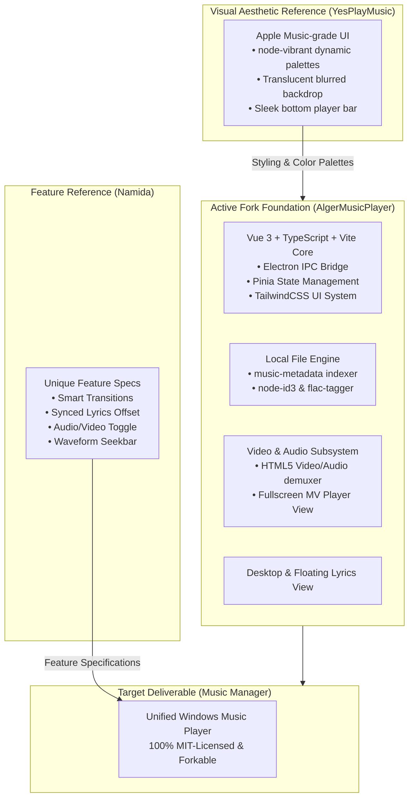

# Music Manager — System Architecture & Technical Comparison

## 1. Executive Summary & Hybrid Architecture Strategy

The goal of this project is to construct a modern, high-performance Windows desktop music player by **forking an open-source, MIT-licensed foundation** and implementing the standout features that made Namida exceptional, while eliminating Namida's closed-source bottlenecks and runtime crashes.

### The Hybrid Fork Architecture:
* **Primary Engineering Engine**: **[AlgerMusicPlayer](file:///C:/Users/kazir/Documents/Agentic%20Harness/Windows%20Exe/Music%20Manager/AlgerMusicPlayer)**
  * *Why:* Built with modern **Vue 3 + TypeScript + Vite + TailwindCSS**. Already features full Electron IPC integration, built-in MV / Video playback view ([`src/renderer/views/mv`](file:///C:/Users/kazir/Documents/Agentic%20Harness/Windows%20Exe/Music%20Manager/AlgerMusicPlayer/src/renderer/views/mv)), local music indexing ([`src/renderer/views/local-music`](file:///C:/Users/kazir/Documents/Agentic%20Harness/Windows%20Exe/Music%20Manager/AlgerMusicPlayer/src/renderer/views/local-music)), and native tagging libraries (`node-id3`, `flac-tagger`, `music-metadata`).
* **Visual Design & Theming Reference**: **[YesPlayMusic](file:///C:/Users/kazir/Documents/Agentic%20Harness/Windows%20Exe/Music%20Manager/YesPlayMusic)**
  * *Why:* Industry-benchmark Apple Music aesthetic, fluid cover-art blurred background shaders, and `node-vibrant` dynamic color extraction.
* **Feature Inspiration Ledger**: **Namida**
  * *Why:* Standout UX concepts (Smart Transitions, audio/video toggle, lyrics timing offset adjustments, waveform seekbar, multi-artist separator parsing).

---

## 2. In-Depth 3-Way Architectural Comparison

| Dimension | **Namida** | **AlgerMusicPlayer** | **YesPlayMusic** |
| :--- | :--- | :--- | :--- |
| **License** | **EULA (Source-Available)** ❌ *Cannot fork or rebrand* | **MIT License** ✅ *100% Permissive FOSS* | **MIT License** ✅ *100% Permissive FOSS* |
| **Open Source Reality** | **Blocked** (Relies on private Git packages; unbuildable) | **100% Public** (Builds with `pnpm build` / `npm run dev`) | **100% Public** (Builds with `yarn electron:serve`) |
| **Framework & Language** | Flutter 3.x (Dart AOT Native) | **Vue 3 + TypeScript + Vite** | Vue 2.6 + JavaScript + Webpack |
| **Runtime Engine** | Flutter Engine + C FFI (`taglib`, `media_kit`) | **Electron 31+ + Chromium + Node.js** | Electron 13+ + Chromium + Node.js |
| **Styling & Design System** | Material 3 / Flutter Custom Canvas widgets | **TailwindCSS + Ant Design / Naive UI + Custom CSS** | Custom SCSS (Apple Music Clone) |
| **Audio / Video Mode Toggle** | **Native** (Audio demuxer to Video texture swap) | **Native** ([`views/mv/`](file:///C:/Users/kazir/Documents/Agentic%20Harness/Windows%20Exe/Music%20Manager/AlgerMusicPlayer/src/renderer/views/mv) dedicated MV view & toggle) | ❌ Audio only (No native video playback view) |
| **Dynamic Palette Extraction** | Custom Flutter color scheme generator | Vibrant / Color extraction utilities | **`node-vibrant`** (Industry-standard gradient palette) |
| **Lyrics Subsystem** | Multi-source, floating overlay, offset slider | **Desktop floating lyrics + synced view** | Word-by-word scrolling karaoke view |
| **Local File & Tagging** | Native `taglib` Dart FFI | **`music-metadata` + `node-id3` + `flac-tagger`** | `music-metadata` (Read-only / Basic) |
| **State Management** | Custom Flutter Controllers (Streams / ValueNotifiers) | **Pinia** with `pinia-plugin-persistedstate` | Vuex Store |
| **Maintainability & Extension**| Low (Heavy Dart controller interdependencies) | **High** (Standard web technologies, easy to inspect) | Medium (Legacy Webpack/Vue 2 dependencies) |

---

## 3. Subsystem Architectural Blueprints for the Hybrid Fork

### 3.1 Audio & Media Player Subsystem
* AlgerMusicPlayer hosts HTML5 Audio and Video pipelines using standard Web Audio API (`AudioContext`).
* Unlike Namida's fragile Dart `StreamController` (which crashes when switching media types), the HTML5 media pipeline allows seamless switching between `<audio>` and `<video>` elements or reusing an existing canvas texture without dropping the global state machine.

### 3.2 Dynamic Color Engine & Offline Cache (Merged from YesPlayMusic into Alger)
* Ported YesPlayMusic's `node-vibrant` extraction service into [`src/renderer/utils/linearColor.ts`](file:///C:/Users/kazir/Documents/Agentic%20Harness/Windows%20Exe/Music%20Manager/AlgerMusicPlayer/src/renderer/utils/linearColor.ts#L1-L165) and Dexie IndexedDB offline cache into [`src/renderer/utils/db.ts`](file:///C:/Users/kazir/Documents/Agentic%20Harness/Windows%20Exe/Music%20Manager/AlgerMusicPlayer/src/renderer/utils/db.ts#L1-L265).
* When album artwork loads, `extractVibrantPalette()` and `applyDynamicPaletteToRoot()` extract:
  - `Vibrant`: Primary player accents and active seekbar colors (`--player-vibrant`, `--color-primary`).
  - `DarkVibrant` / `DarkMuted`: Dynamic background gradient mesh (`--player-dark-vibrant`, `--player-dark-muted`, `--color-bg-gradient`).
  - `LightVibrant`: Text headings and contrast highlights (`--player-light-vibrant`).

### 3.3 Smart Transitions & 200ms Fade Engine (Web Audio Implementation)
* Implemented in [`src/renderer/services/audioService.ts`](file:///C:/Users/kazir/Documents/Agentic%20Harness/Windows%20Exe/Music%20Manager/AlgerMusicPlayer/src/renderer/services/audioService.ts#L5-L965):
  - **Smooth 200ms Play/Pause Fade**: `PLAY_PAUSE_FADE_DURATION = 200` linear gain ramp (`fadeInVolume` and `pause(withFade)`).
  - **Equal-Power Crossfade**: Cosine gain envelope over configurable seconds ($t_{\text{fade}} = 1\text{s} - 10\text{s}$) in `handleSmartTransitionTick()`.
  - **Skip Silence**: Analyzing initial and trailing RMS amplitude below $-50\text{dBFS}$ (`getRmsDb()`) via `AnalyserNode` to advance playheads automatically.
  - **ReplayGain Loudness Normalization**: Applies dB-to-linear gain scaling in `getEffectiveVolume()`.
  - **A-B Segment Loop & Bookmarks**: High-precision segment looping (`setAbLoopPointA`, `setAbLoopPointB`, `clearAbLoop`) and per-track bookmarks (`addBookmark`, `getBookmarks`) integrated into the playback tick loop.

### 3.4 Multi-Source Lyrics, Metadata Tagging & Diagnostics Subsystems
* **Multi-Source Lyrics & Phonetic Transliteration** ([`src/main/modules/tagAndMetadataManager.ts`](file:///C:/Users/kazir/Documents/Agentic%20Harness/Windows%20Exe/Music%20Manager/AlgerMusicPlayer/src/main/modules/tagAndMetadataManager.ts#L1-L600), [`src/shared/transliteration.ts`](file:///C:/Users/kazir/Documents/Agentic%20Harness/Windows%20Exe/Music%20Manager/AlgerMusicPlayer/src/shared/transliteration.ts#L1-L260)):
  - Queries LRCLIB and NetEase APIs for synced/plain lyrics across English, Japanese, and Bangla songs, automatically generating Hepburn Romaji (`romanizeJapaneseKana`) and phonetic Bangla (`romanizeBangla`) subtitles (`romalrc`), plus an interactive in-app LRC Timestamp Synchronizer ([`LrcSynchronizerModal.vue`](file:///C:/Users/kazir/Documents/Agentic%20Harness/Windows%20Exe/Music%20Manager/AlgerMusicPlayer/src/renderer/components/common/LrcSynchronizerModal.vue)).
* **Online Artwork/Tag Auto-Fetcher, Physical File Renamer & M3U8/JSON Backup**:
  - Queries iTunes Search API and MusicBrainz + Cover Art Archive (`metadata:fetch-online`), embeds ID3v2/FLAC tags and cover art (`local-music:update-tags-and-file`), renames the physical file on disk, and exports/imports `.m3u8` playlists and `.json` library backups.
* **Built-in Error Telemetry & HTTP/SSE Watch API** ([`src/main/modules/errorReporter.ts`](file:///C:/Users/kazir/Documents/Agentic%20Harness/Windows%20Exe/Music%20Manager/AlgerMusicPlayer/src/main/modules/errorReporter.ts#L1-L240)):
  - Captures main process, renderer, Vue, IPC, and audio pipeline errors to `<userData>/logs/error-reports.json` and serves a live HTTP REST & Server-Sent Events (SSE) watch endpoint at `http://127.0.0.1:41820/api/diagnostics` and `/api/diagnostics/stream`.

### 3.5 Portable Binary Packaging Pipeline
* Configured in [`AlgerMusicPlayer/package.json`](file:///C:/Users/kazir/Documents/Agentic%20Harness/Windows%20Exe/Music%20Manager/AlgerMusicPlayer/package.json#L23-L197) (`npm run build:portable`):
  - Pre-build verification and engine retrieval via [`scripts/fetch-binaries.mjs`](file:///C:/Users/kazir/Documents/Agentic%20Harness/Windows%20Exe/Music%20Manager/AlgerMusicPlayer/scripts/fetch-binaries.mjs).
  - Compiles main, preload, and renderer bundles via `electron-vite build` and packages a standalone x64 Windows portable executable (`MusicManager-v5.3.5-Portable.exe`) via `electron-builder --win portable --x64 --publish never`.
  - Versioned portable deliverable: [`releases/MusicManager-v5.3.5-Portable.exe`](file:///C:/Users/kazir/Documents/Agentic%20Harness/Windows%20Exe/Music%20Manager/releases/MusicManager-v5.3.5-Portable.exe) (`446.9 MB`, down from `474.3 MB` in v5.2.0; includes bundled `yt-dlp` and `ffmpeg` engine).
  - **Installer target** (shipping format, wired but not yet run): `npm run build:installer` → `electron-builder --win nsis`. The NSIS configuration (`oneClick: false`, `allowToChangeInstallationDirectory`, desktop/start-menu shortcuts, `build/installer.nsh`) is complete and unchanged; `win.target` remains `portable` for rapid testing.
  - **Size budget**: `Music Manager.exe` (Electron/Chromium runtime, ~204 MB) and `resources/bin/ffmpeg.exe` (~79 MB) together are 63% of the artifact and are not reducible without losing functionality. The portable `.exe` is smaller than the sum of its parts because electron-builder's portable target is a 7z self-extractor, which compresses `app.asar` heavily.
  - **Single-ffmpeg invariant**: `getFfmpegPath()` in [`src/main/modules/youtube.ts`](file:///C:/Users/kazir/Documents/Agentic%20Harness/Windows%20Exe/Music%20Manager/AlgerMusicPlayer/src/main/modules/youtube.ts) is the only ffmpeg resolver, and `resources/bin/ffmpeg.exe` is the only copy. `build.electronLanguages` is restricted to `['en-US']` to avoid shipping ~54 unused Chromium locale paks. See [`BUGS.md`](BUGS.md) §6 for the static-inspection procedure used to validate packaging changes without a GUI.
  - Unpacked fast-launch binaries in [`AlgerMusicPlayer/dist/win-unpacked/Music Manager.exe`](file:///C:/Users/kazir/Documents/Agentic%20Harness/Windows%20Exe/Music%20Manager/AlgerMusicPlayer/dist/win-unpacked/Music%20Manager.exe).

### 3.6 YouTube Engine Subsystem (`yt-dlp` + `ffmpeg-static` + DASH Proxy)
* **Format Extraction & Fallback Chain** ([`src/main/modules/youtube.ts`](file:///C:/Users/kazir/Documents/Agentic%20Harness/Windows%20Exe/Music%20Manager/AlgerMusicPlayer/src/main/modules/youtube.ts), [`src/renderer/utils/videoQualityHelpers.ts`](file:///C:/Users/kazir/Documents/Agentic%20Harness/Windows%20Exe/Music%20Manager/AlgerMusicPlayer/src/renderer/utils/videoQualityHelpers.ts)):
  - Executes `yt-dlp` with `--extractor-args "youtube:player_client=all"` to extract the complete video quality ladder (`1080p`, `720p`, `480p`, `360p`, `240p`, `144p`).
  - Implements multi-client fallback: `all` $\rightarrow$ `web,android` $\rightarrow$ `ios` to guarantee format availability across geoblocks.
* **Ephemeral Local DASH Proxy Muxer**:
  - Spawns a local HTTP server on `127.0.0.1` (`ffmpeg -c copy -f mp4 -movflags frag_keyframe+empty_moov`) to multiplex separate video-only (1080p) and audio-only streams on the fly into standard progressive MP4 without transcoding delay, allowing Chromium's native `<video>` tag to stream 1080p directly.
  - **v5.4.0 linked A/V default**: streams and downloads now request **video-only** formats (`bestvideo`, no audio merge) because playback is linked (§3.12) — the song's audio file is the sound source. This skips the mux proxy (the video URL is directly range-seekable) and produces smaller files; the proxy remains only as a seek fallback for legacy muxed streams.
* **Background Downloading & Progress Tracking** ([`src/main/modules/youtube.ts`](file:///C:/Users/kazir/Documents/Agentic%20Harness/Windows%20Exe/Music%20Manager/AlgerMusicPlayer/src/main/modules/youtube.ts)):
  - Downloads video/audio in the background to user-configured or auto download directory (`downloads/video/`), emitting real-time percent and speed events over IPC to drive inline progress rings in the UI.

### 3.7 Unified Song Database Subsystem (`musicManagerLibrary` Dexie DB)
* Located in [`src/renderer/services/songLibrary.ts`](file:///C:/Users/kazir/Documents/Agentic%20Harness/Windows%20Exe/Music%20Manager/AlgerMusicPlayer/src/renderer/services/songLibrary.ts):
  - Consolidates multiple media files (low-bitrate MP3, high-bitrate FLAC/M4A, MP4 music videos) under a single canonical `Song` entity using title/artist token Jaccard similarity ($\ge 0.85$) and duration tolerance ($\pm 5\text{s}$).
  - Stores multiple audio and video variants with individual bitrate, resolution, container format, and file size.
  - Automatically records and restores per-track playback position and preferred variant (audio vs video) across sessions.

### 3.8 Global Playback Exclusivity Coordinator Subsystem
* Located in [`src/renderer/services/mediaCoordinator.ts`](file:///C:/Users/kazir/Documents/Agentic%20Harness/Windows%20Exe/Music%20Manager/AlgerMusicPlayer/src/renderer/services/mediaCoordinator.ts):
  - Guarantees strict single-playback exclusivity across main audio player, fullscreen MV player, PiP popup, secondary windows, and synchronizer preview players.
  - Intercepts playback events; whenever any registered media begins playing, all other media players are automatically paused and silenced to prevent audio collisions.
  - **v5.4.0 exceptions**: a *muted* element (the linked A/V video of §3.12) is not an audible surface and never claims exclusivity from the audio it follows; `toggleActiveNonAudioPlayback()` lets the shared play button control whichever non-audio surface (e.g. the MV drawer) currently owns playback.

### 3.9 Namida Stacked Player & Video UI Subsystem
* Components:
  - [`NamidaStackedPlayer.vue`](file:///C:/Users/kazir/Documents/Agentic%20Harness/Windows%20Exe/Music%20Manager/AlgerMusicPlayer/src/renderer/components/player/NamidaStackedPlayer.vue): Centered album artwork with dynamic glow, one-line synced lyrics directly beneath artwork, full-width responsive waveform visualizer (`min-height: 56px`), large circular controls (Play/Pause, Previous, Next), and bottom-left `[🎬 Video • <size>]` pill.
  - [`VideoSourcePopover.vue`](file:///C:/Users/kazir/Documents/Agentic%20Harness/Windows%20Exe/Music%20Manager/AlgerMusicPlayer/src/renderer/components/player/VideoSourcePopover.vue): Popover menu supporting real-time YouTube search, direct YouTube URL binding, quality picker (`1080p` to `144p`), and background download with progress ring.
  - [`SaveToDiskModal.vue`](file:///C:/Users/kazir/Documents/Agentic%20Harness/Windows%20Exe/Music%20Manager/AlgerMusicPlayer/src/renderer/components/player/SaveToDiskModal.vue): Dedicated modal to save the audio version, video version, or `.lrc` lyric sidecar to any chosen folder on disk.

### 3.10 Local Protocol, Tag Editor & LRC Synchronizer Subsystem
* [`localProtocol.ts`](file:///C:/Users/kazir/Documents/Agentic%20Harness/Windows%20Exe/Music%20Manager/AlgerMusicPlayer/src/main/modules/localProtocol.ts):
  - Custom `local-file://` protocol handler with full CORS support (`Access-Control-Allow-Origin: *`) and HTTP 206 partial content range requests.
  - Disk cover art extraction with fallbacks (`cover.jpg`, `folder.png`, embedded tags).
* [`tagAndMetadataManager.ts`](file:///C:/Users/kazir/Documents/Agentic%20Harness/Windows%20Exe/Music%20Manager/AlgerMusicPlayer/src/main/modules/tagAndMetadataManager.ts):
  - Native tag writing for `.mp3` (ID3v2), `.flac` (Vorbis), and `.m4a` / `.mp4` (iTunes metadata atoms via bundled `ffmpeg-static`).
  - Atomic rename with exponential retry backoff to survive Windows file locking.
* [`LrcSynchronizerModal.vue`](file:///C:/Users/kazir/Documents/Agentic%20Harness/Windows%20Exe/Music%20Manager/AlgerMusicPlayer/src/renderer/components/common/LrcSynchronizerModal.vue):
  - Overhauled interactive synchronizer featuring embedded mini player with Play/Pause, scrubber, $\pm 5\text{s}$ and $\pm 10\text{s}$ skip buttons, per-line ▶ preview test, configurable nudge step ($\pm 0.1\text{s}$, $\pm 0.5\text{s}$, $\pm 1\text{s}$), global offset shift, and dual saving (embedded audio tags + `.lrc` sidecar).

### 3.11 English-Only Source Invariant (v5.3.0)
* All user-visible source text and all comments under `src/**` are English. The v5.2 De-China work removed the Chinese *features* and locale packs; v5.3.0 finished the *source text*.
* Numeric formatting uses the Western scale (`M` = 1e6, `B` = 1e9) via `formatNumber()` in [`src/renderer/utils/index.ts`](file:///C:/Users/kazir/Documents/Agentic%20Harness/Windows%20Exe/Music%20Manager/AlgerMusicPlayer/src/renderer/utils/index.ts).
* Four CJK exemptions are deliberate and **must survive future upstream rebases**: `src/shared/transliteration.ts` (romanisation data), `src/i18n/lang/**` (locale bundles), `HEADER_KEYWORD_RE` in [`lxListParser.ts`](file:///C:/Users/kazir/Documents/Agentic%20Harness/Windows%20Exe/Music%20Manager/AlgerMusicPlayer/src/renderer/utils/lxListParser.ts) (matches CJK/Korean/Japanese column headers in imported playlists), and `fontPreview.chineseText` in the `en-US` settings bundle (CJK font-rendering sample). Full rationale and the re-sweep workflow: [`REMOVED_FEATURES.md`](REMOVED_FEATURES.md) §7.
* Regression gate: `node .sweep-gate.mjs` from `AlgerMusicPlayer/` must report 0 unexplained CJK lines.
* Pitfall for mechanical re-sweeps: stripping a comment from `catch { // reason }` yields `catch {}`, which trips ESLint `no-empty` and silently discards the reason an error is ignored. Rewrite those comments in English rather than deleting them.

### 3.12 Linked A/V Playback & Per-Song Media Lifecycle (v5.4.0)
* **Linked A/V model** ([`src/renderer/components/lyric/MusicFull.vue`](file:///C:/Users/kazir/Documents/Agentic%20Harness/Windows%20Exe/Music%20Manager/AlgerMusicPlayer/src/renderer/components/lyric/MusicFull.vue)):
  - The song's audio element is always the master clock and the only sound source, even in video mode. The `<video>` element is **muted** and follows it (slave of `playerStore.isPlay`, drift-corrected above 0.75s). Audio and video share one duration/position by construction; there is no double audio and no gap when switching modes (nothing is paused, the video joins when its metadata is ready).
  - One play state (`playerStore.isPlay` = audio state) drives every play button; `usePlaybackControl` routes toggles through `mediaCoordinator.toggleActiveNonAudioPlayback()` first (MV drawer etc.), and `handlePause` stops all surfaces.
* **Per-song media reset** ([`src/renderer/services/playbackController.ts`](file:///C:/Users/kazir/Documents/Agentic%20Harness/Windows%20Exe/Music%20Manager/AlgerMusicPlayer/src/renderer/services/playbackController.ts), [`src/renderer/store/modules/playerCore.ts`](file:///C:/Users/kazir/Documents/Agentic%20Harness/Windows%20Exe/Music%20Manager/AlgerMusicPlayer/src/renderer/store/modules/playerCore.ts)):
  - Media (video stream, quality, YouTube link) is matched by song ID, so `playTrack` calls `resetMediaStateForNewSong()` on id change and `MusicFull` clears its video state — the previous song's video/artwork/pill can no longer survive a track change. The mode pill reads `Video • <height>p` or `Audio • <bitrate>`.
* **Per-codec quality ladder** ([`src/main/modules/youtubeFormats.ts`](file:///C:/Users/kazir/Documents/Agentic%20Harness/Windows%20Exe/Music%20Manager/AlgerMusicPlayer/src/main/modules/youtubeFormats.ts), [`src/renderer/components/player/VideoSourcePopover.vue`](file:///C:/Users/kazir/Documents/Agentic%20Harness/Windows%20Exe/Music%20Manager/AlgerMusicPlayer/src/renderer/components/player/VideoSourcePopover.vue)):
  - Quality rows are one per (height, codec) with `mp4 • codec • bitrate` detail and a single size badge; downloads use the exact `formatId`, record `codec`/`formatId` on the `Variant`, and offer completion ticks plus per-variant deletion.
* **Edit LRC & lyric match picking** ([`src/renderer/components/common/LrcSynchronizerModal.vue`](file:///C:/Users/kazir/Documents/Agentic%20Harness/Windows%20Exe/Music%20Manager/AlgerMusicPlayer/src/renderer/components/common/LrcSynchronizerModal.vue), [`src/main/modules/tagAndMetadataManager.ts`](file:///C:/Users/kazir/Documents/Agentic%20Harness/Windows%20Exe/Music%20Manager/AlgerMusicPlayer/src/main/modules/tagAndMetadataManager.ts)):
  - "Edit LRC" opens the synchronizer with raw `[mm:ss.xxx]` timestamps, per-line ±0.1s nudges that follow playback, and live apply to the player. Lyric search candidates carry `duration`/`durationDelta`/`offsetSec`/`durationMatch` so the user can pick the version closest to their file; a glass banner warns when linked audio/video lengths differ by >3s.
